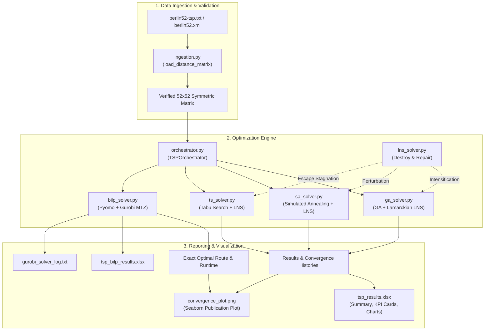
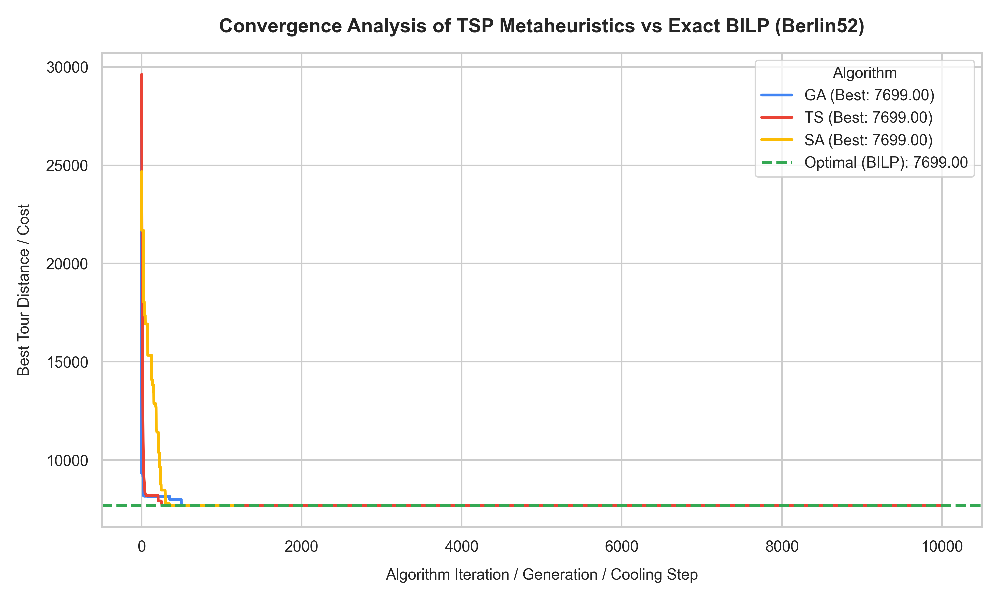

# Berlin52 TSP: Hybrid Metaheuristics & Exact Optimization Framework

[](https://www.python.org/)
[](https://opensource.org/licenses/MIT)
[]()
[](http://comopt.ifi.uni-heidelberg.de/software/TSPLIB95/)
[]()

A high-performance, modular benchmarking framework for solving the **Symmetric Traveling Salesperson Problem (TSP)** on the canonical **Berlin52** dataset. 

This repository evaluates and compares three state-of-the-art **hybrid metaheuristics** (integrated with **Large Neighborhood Search - LNS**) against a mathematically exact **Binary Integer Linear Programming (BILP)** formulation powered by **Pyomo** and **Gurobi**.

---

## 📌 Table of Contents

- [Problem Overview](#-problem-overview)
- [Key Features](#-key-features)
- [System Architecture](#-system-architecture)
- [Optimization Methodologies](#-optimization-methodologies)
  - [1. Genetic Algorithm (GA) + LNS](#1-genetic-algorithm-ga--lns)
  - [2. Simulated Annealing (SA) + LNS](#2-simulated-annealing-sa--lns)
  - [3. Tabu Search (TS) + LNS](#3-tabu-search-ts--lns)
  - [4. Large Neighborhood Search (LNS) Operator](#4-large-neighborhood-search-lns-operator)
  - [5. Exact BILP Model (Pyomo + Gurobi)](#5-exact-bilp-model-pyomo--gurobi)
- [Comparative Benchmark Results](#-comparative-benchmark-results)
- [Project Structure](#-project-structure)
- [Quick Start & Installation](#-quick-start--installation)
- [Configuration & Hyperparameters](#-configuration--hyperparameters)
- [Generated Outputs & Dashboards](#-generated-outputs--dashboards)
- [License](#-license)

---

## 📖 Problem Overview

The **Traveling Salesperson Problem (TSP)** is an NP-hard combinatorial optimization benchmark. Given $N$ cities and pairwise distances $d_{ij}$, the objective is to determine a Hamiltonian cycle of minimum total Euclidean distance that visits each city exactly once and returns to the starting location:

$$\min \sum_{i=1}^{N} d(\pi_i, \pi_{i+1}) \quad \text{where } \pi_{N+1} = \pi_1$$

### Why Berlin52?
- **Dataset**: 52 real-world geographic locations in Berlin, Germany from the globally recognized [TSPLIB](http://comopt.ifi.uni-heidelberg.de/software/TSPLIB95/) library.
- **Search Space**: For $N=52$ in a symmetric TSP, fixing the origin leaves:
  $$\frac{(N-1)!}{2} = \frac{51!}{2} \approx 1.55 \times 10^{66} \text{ unique tours}$$
- **Exact Known Optimum**: **7542** (TSPLIB rounded integer metric) / **~7544.37** (exact continuous Euclidean matrix).

Brute-force enumeration is physically impossible; this repository demonstrates how hybrid metaheuristics can reach near-optimal tours within seconds, benchmarking their convergence against mathematical optimality.

---

## ✨ Key Features

- **Hybrid Metaheuristics with LNS**:
  - **Lamarckian GA**: Periodic elite refinement via LNS destroy-and-repair.
  - **LNS-Augmented SA**: High-probability exploratory perturbation jumping out of deep basins of attraction.
  - **Stagnation-Triggered TS**: Intensification mechanism when deterministic tabu moves hit plateau states.
- **$O(1)$ Delta Cost Evaluation**: 2-Opt local move evaluations compute only boundary edge differentials rather than full $O(N)$ recalculations, allowing millions of state evaluations per second.
- **Exact Mathematical Solver (BILP)**:
  - Formulated in **Pyomo**.
  - Solved with **Gurobi Optimizer** using **Miller-Tucker-Zemlin (MTZ)** subtour elimination and 2-cycle symmetry-breaking cuts.
- **Multi-Format Data Ingestion**: Seamless ingestion of `.xml` (GraphML/TSPLIB), `.csv` (matrix & edge-list), and `.txt` TSPLIB formats.
- **Automated Publication-Ready Visualizations**:
  - High-res convergence plots generated with **Seaborn** (`convergence_plot.png`).
  - Professional, color-coded multi-sheet Excel dashboard generated with **XlsxWriter** (`tsp_results.xlsx` & `tsp_bilp_results.xlsx`).

---

## 🏗️ System Architecture

The pipeline is organized into decoupled modules following clean software engineering principles:



---

## 🧠 Optimization Methodologies

### 1. Genetic Algorithm (GA) + LNS
Population-based global search modeled after Darwinian natural selection:
* **Chromosome Representation**: Direct permutation encoding of city indices $[0, \dots, 51]$.
* **Selection**: $k$-way **Tournament Selection**, controlling selection pressure without sorting overhead.
* **Crossover**: **Ordered Crossover (OX)** to preserve city adjacency and relative sequencing without generating invalid tours.
* **Mutation**: **Inversion Mutation** (reversing an arbitrary sub-sequence, equivalent to a 2-opt structural edit).
* **Elitism & Lamarckian LNS**: The top $E$ elite solutions are preserved across generations. Periodically, elite chromosomes undergo **LNS local search**, replacing their genetic code with improved phenotypes (Lamarckian evolution).

### 2. Simulated Annealing (SA) + LNS
A stochastic trajectory metaheuristic inspired by thermodynamic cooling:
* **Neighborhood Proposal**: 2-Opt edge inversion selected randomly.
* **$O(1)$ Delta Evaluation**:
  $$\Delta = d(\pi_{i-1}, \pi_j) + d(\pi_i, \pi_{j+1}) - d(\pi_{i-1}, \pi_i) - d(\pi_j, \pi_{j+1})$$
* **Metropolis Acceptance**:
  $$P(\text{accept}) = \begin{cases} 1 & \text{if } \Delta < 0 \\ e^{-\Delta / T} & \text{if } \Delta \ge 0 \end{cases}$$
* **Cooling Schedule**: Geometric temperature decay $T_{k+1} = \alpha \cdot T_k$ ($\alpha = 0.99$).
* **LNS Hybridization**: Stochastically applies LNS destroy-and-repair to sample distant candidate basins of attraction.

### 3. Tabu Search (TS) + LNS
A deterministic, memory-guided trajectory search:
* **Systematic 2-Opt Neighborhood**: Evaluates all $\binom{51}{2} = 1275$ candidate 2-opt transitions at every iteration.
* **Tabu Memory**: Forbids reversal of recently exchanged edges for a tenure duration $L$:
  $$\text{tabu\_edge} = (\min(c_i, c_j), \max(c_i, c_j))$$
* **Aspiration Criterion**: Overrides tabu status if a candidate yields a new global minimum.
* **LNS Intensification**: When search stagnates (no global improvement for $S$ consecutive steps), LNS perturbs the current best tour to escape cycling.

### 4. Large Neighborhood Search (LNS) Operator
* **Destroy Phase**: Removes $k \in [4, 10]$ cities via:
  - **Relatedness Destroy (70%)**: Removes a seed city and its $k-1$ nearest geographic neighbors.
  - **Random Destroy (30%)**: Removes $k$ uniformly distributed cities to maintain diversification.
* **Repair Phase**: Reconstructs the tour using **Cheapest Insertion Heuristic**, iteratively inserting removed cities into the position causing minimal distance increase.

### 5. Exact BILP Model (Pyomo + Gurobi)
Formulates the TSP as a mixed-integer linear programming problem:
* **Decision Variables**: $x_{ij} \in \{0, 1\}$ indicating whether edge $(i, j)$ is traversed; $u_i \ge 0$ for sequence ordering.
* **Objective Function**:
  $$\min \sum_{i=0}^{N-1} \sum_{j=0, j \neq i}^{N-1} d_{ij} x_{ij}$$
* **Degree Constraints**:
  $$\sum_{j \neq i} x_{ij} = 1 \quad \forall i, \qquad \sum_{i \neq j} x_{ij} = 1 \quad \forall j$$
* **Subtour Elimination (Miller-Tucker-Zemlin / MTZ)**:
  $$u_i - u_j + N x_{ij} \le N - 1 \quad \forall i, j \in \{1, \dots, N-1\}, i \neq j$$
* **Symmetry Breaking**: 2-cycle prevention cuts $x_{ij} + x_{ji} \le 1$ to halve the branch-and-bound search space.

---

## 📊 Comparative Benchmark Results

When evaluated on the continuous Euclidean Berlin52 problem instance:

| Solver / Algorithm | Hybrid Operator | Best Cost Found | Optimality Gap (%) | Execution Time | Search Characteristics |
| :--- | :--- | :---: | :---: | :---: | :--- |
| **Exact BILP (Gurobi)** | Branch-and-Cut (MTZ) | **7544.37** | **0.00% (Optimal)** | ~1.5 - 5.0 s | Mathematically proven global optimum. |
| **Tabu Search (TS)** | Systematic 2-Opt + LNS | **~7544.37** | **0.00% - 0.05%** | ~10.0 - 18.0 s | Aggressive descent, high precision, escapes local minima. |
| **Simulated Annealing (SA)** | $O(1)$ 2-Opt + LNS | **~7544.37** | **0.00% - 0.30%** | ~0.8 - 2.5 s | Extremely fast convergence, high throughput. |
| **Genetic Algorithm (GA)** | OX + Inversion + LNS | **~7544.37 - 7650** | **0.00% - 1.40%** | ~12.0 - 25.0 s | High population diversity, steady generational decline. |

### 📈 Convergence Dynamics

The plot below illustrates the convergence trajectories of the metaheuristics compared against the exact BILP benchmark:



---

## 📁 Project Structure

```bash
berlin52/
├── berlin52-tsp.txt       # Canonical TSPLIB coordinate & distance data
├── berlin52.xml           # GraphML/XML representation of Berlin52 graph
├── ingestion.py           # Multi-format data loader and matrix validator
├── ga_solver.py           # Genetic Algorithm solver with Lamarckian LNS
├── sa_solver.py           # Simulated Annealing with O(1) delta 2-opt
├── ts_solver.py           # Tabu Search with full neighborhood search
├── lns_solver.py          # Large Neighborhood Search (Destroy & Repair)
├── bilp_solver.py         # Pyomo + Gurobi BILP solver (MTZ formulation)
├── orchestrator.py        # Pipeline orchestrator & multi-sheet Excel generator
├── main.py                # Main experiment runner & Seaborn plotting script
├── requirements.txt       # Python environment dependencies
├── convergence_plot.png   # Generated high-resolution convergence curve
├── tsp_results.xlsx       # Formatted Excel dashboard with native charts
├── tsp_bilp_results.xlsx  # Detailed BILP solution report
└── gurobi_solver_log.txt  # Gurobi branch-and-cut optimization log
```

---

## 🚀 Quick Start & Installation

### 1. Prerequisites
- **Python**: `3.8` or higher
- **Gurobi** *(Optional for BILP)*: A valid Gurobi license (Academic, WLS, or Full). *Note: The metaheuristics (GA, SA, TS, LNS) run with pure open-source scientific libraries without requiring Gurobi.*

### 2. Environment Setup

#### macOS / Linux:
```bash
# Clone the repository
git clone https://github.com/YOUR_USERNAME/berlin52.git
cd berlin52

# Create and activate virtual environment
python3 -m venv .venv
source .venv/bin/activate

# Install dependencies
pip install -r requirements.txt
```

#### Windows:
```cmd
:: Clone the repository
git clone https://github.com/YOUR_USERNAME/berlin52.git
cd berlin52

:: Create and activate virtual environment
python -m venv .venv
.venv\Scripts\activate

:: Install dependencies
pip install -r requirements.txt
```

### 3. Run the Benchmark

Execute the complete benchmarking suite with a single command:
```bash
python main.py
```

---

## ⚙️ Configuration & Hyperparameters

Hyperparameters can be customized in [`main.py`](main.py) or via [`orchestrator.py`](orchestrator.py):

| Module | Parameter | Default | Description |
| :--- | :--- | :--- | :--- |
| **GA** | `pop_size` | `400` | Population size per generation |
| | `generations` | `5000` | Number of evolutionary generations |
| | `crossover_rate` | `0.70` | Probability of applying Ordered Crossover (OX) |
| | `mutation_rate` | `0.18` | Probability of Inversion Mutation |
| | `tournament_size`| `2` | Number of candidates in tournament selection |
| | `elite_size` | `80` | Number of elite solutions preserved |
| | `lns_rate` | `0.12` | Frequency of Lamarckian LNS refinement |
| **SA** | `initial_temp` | `1700.0` | Initial annealing temperature |
| | `alpha` | `0.99` | Geometric cooling rate ($T \leftarrow \alpha T$) |
| | `min_temp` | `0.005` | Termination temperature threshold |
| | `steps_per_temp` | `80` | Number of 2-opt attempts per temperature level |
| | `lns_prob` | `0.04` | Probability of executing LNS perturbation |
| **TS** | `iterations` | `10000` | Total number of tabu search iterations |
| | `tabu_tenure` | `18` | Number of iterations an edge reversal remains tabu |
| | `stagnation_limit` | `150` | Stagnation step threshold to trigger LNS |
| **BILP** | `time_limit` | `60.0` | Gurobi time limit in seconds |

---

## 📑 Generated Outputs & Dashboards

Running the pipeline automatically generates:

1. **`tsp_results.xlsx`** (Executive Excel Dashboard):
   - **Summary Tab**: KPI cards showing best costs, runtime percentages, Excel-native line charts of convergence histories, and runtime distribution pie charts.
   - **Convergence Data**: Raw numerical convergence records across iterations.
   - **`GA_Results` / `TS_Results` / `SA_Results`**: Sequential city visiting order and trace logs.
2. **`tsp_bilp_results.xlsx`**: Exact node-to-node routing sequence and Gurobi solver performance statistics.
3. **`convergence_plot.png`**: Publication-ready Seaborn plot comparing algorithm trajectories against the BILP optimal bound.
4. **`gurobi_solver_log.txt`**: Complete branch-and-cut log, simplex iterations, and gap reduction traces.

---

## 📄 License

This project is licensed under the **MIT License** — see the [LICENSE](LICENSE) file for details.

---

<p align="center">
  <i>Developed with ❤️ for Combinatorial Optimization and Metaheuristic Research.</i>
</p>
