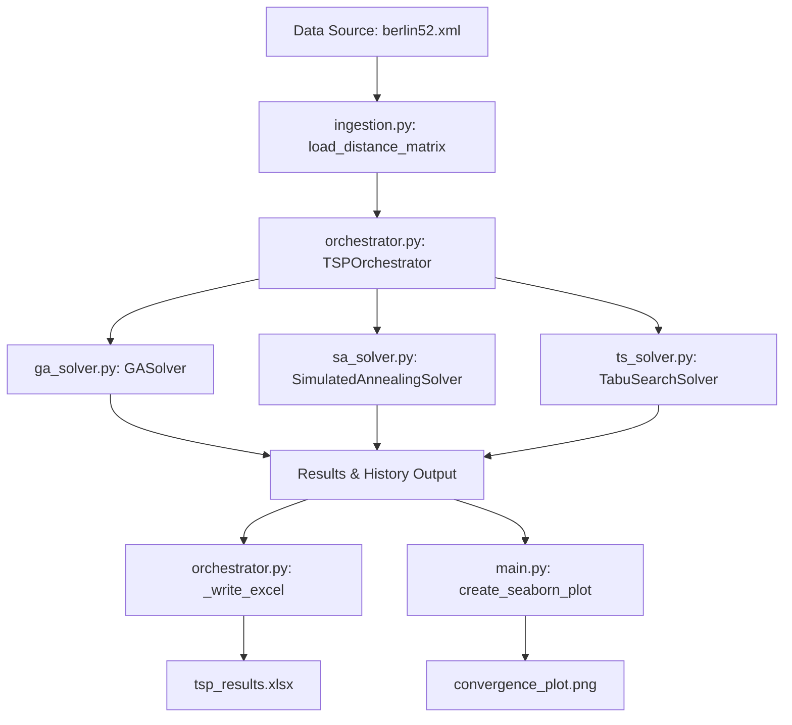

# Comparative Performance Analysis of Metaheuristic Solvers on the Berlin52 Symmetric Traveling Salesperson Problem (TSP)

This document serves as a comprehensive academic reference report detailing the optimization framework, algorithm design choices, parameters, and results for solving the **Symmetric Traveling Salesperson Problem (TSP)** using the **Berlin52** dataset. It analyzes three primary metaheuristic approaches implemented in this project: **Genetic Algorithm (GA)**, **Simulated Annealing (SA)**, and **Tabu Search (TS)**.

---

## 1. Problem Formulation: Symmetric TSP and Berlin52 Dataset

### 1.1 The Symmetric Traveling Salesperson Problem (TSP)
The Traveling Salesperson Problem is a classic NP-hard combinatorial optimization problem. Given a set of cities and the distances between each pair of cities, the goal is to find the shortest possible route that visits each city exactly once and returns to the origin city.

Mathematically, let $G = (V, E)$ be a complete undirected graph where:
*   $V = \{0, 1, \dots, N-1\}$ is the set of $N$ vertices (cities).
*   $E = \{(i, j) \mid i, j \in V, i \neq j\}$ is the set of edges.
*   $D = [d_{ij}]$ is a distance matrix where $d_{ij} \ge 0$ represents the weight (distance) of edge $(i, j)$.

In a **Symmetric TSP**, the distance matrix is symmetric:
$$d_{ij} = d_{ji} \quad \forall i, j \in V$$

This symmetry implies that the direction of traversal along any edge does not affect the cost. Consequently, for any valid tour path, its reverse sequence yields the exact same total distance. The search space of unique undirected tours is given by:
$$\frac{(N-1)!}{2}$$

For $N = 52$, this search space size is $\approx 1.55 \times 10^{66}$ unique tours, making exhaustive search computationally impossible and highlighting the necessity of metaheuristics.

### 1.2 Berlin52 Problem Instance
The project utilizes the **berlin52** problem instance from the TSPLIB library. 
*   **Properties**: 52 locations in Berlin, Germany.
*   **Data Representation**: The problem data is stored in [berlin52.xml](file:///Users/sami/berlin52/berlin52.xml), defining explicit edge costs between vertices.
*   **Symmetry Verification**: The distance matrix is symmetric, which is verified during ingestion.
*   **Search Optimization**: To eliminate circular shift duplicates, the solvers arbitrarily fix the starting city as City 0 at index 0 of the tour array. This reduces the search space by a factor of $N$ while preserving the search for the optimal relative order.

---

## 2. Solution Pipeline & Software Architecture

The framework is structured as a modular pipeline to separate data loading, algorithm execution, orchestration, and reporting.

### 2.1 Ingestion Component (`ingestion.py`)
The [ingestion.py](file:///Users/sami/berlin52/ingestion.py) module handles the parsing and cleaning of the input problem instance.
*   **Format Support**: Parses `.xml` (TSPLIB XML representation), `.csv` (matrix and edge-list formats), and `.xlsx` files.
*   **XML Parsing**: Extracts the `<graph>` element and traverses `<vertex>` and `<edge>` nodes, populating a 2D NumPy array matrix of size $52 \times 52$.
*   **Clean Adjacency Matrix**: The output is a verified, fully connected distance matrix where the $i$-th row and $j$-th column contains the Euclidean distance cost $d_{ij}$.

### 2.2 Orchestration Component (`orchestrator.py`)
The [orchestrator.py](file:///Users/sami/berlin52/orchestrator.py) module houses the `TSPOrchestrator` class. It manages:
*   **Solver Instantiation**: Loads the solvers with customized or default configurations.
*   **Execution Monitoring**: Measures CPU execution runtimes.
*   **Unified Reporting**: Compiles all solutions and history logs into a multi-sheet Excel file [tsp_results.xlsx](file:///Users/sami/berlin52/tsp_results.xlsx) using the `xlsxwriter` library, featuring:
    *   **Summary Sheet**: A clean dashboard containing comparison tables, config metadata, a convergence line chart, and a runtime allocation pie chart.
    *   **Convergence Data Sheet**: Source tabular data for charting.
    *   **Algorithm Specific Sheets**: Route position files mapping city indices and step-by-step convergence values.

### 2.3 Execution Entrypoint (`main.py`)
The [main.py](file:///Users/sami/berlin52/main.py) script serves as the main script. It imports the orchestrator, overrides default parameters, runs the experiment, and uses Seaborn to plot the convergence behavior to [convergence_plot.png](file:///Users/sami/berlin52/convergence_plot.png).

---

## 3. Algorithm Design Choices and Justifications

### 3.1 Genetic Algorithm (GA)
Genetic Algorithms are population-based search methods inspired by natural selection. The solver is defined in [ga_solver.py](file:///Users/sami/berlin52/ga_solver.py).

#### Representation
*   **Encoding**: Permutation encoding. An individual is represented as a list of integers from $0$ to $51$.
*   **Initial Population**: Generated via purely random shuffles of the city list, ensuring diverse starting points across the search space.

#### Selection Operator: Tournament Selection
*   **Mechanism**: Randomly chooses $k$ individuals (tournament size) and returns the one with the lowest tour cost.
*   **Justification**: Tournament selection allows tuning selection pressure by adjusting $k$. A larger tournament size increases selection pressure, focusing search on high-fit individuals, whereas a smaller size maintains diversity. It does not require sorting the entire population by fitness, avoiding computational bottlenecks.

#### Crossover Operator: Ordered Crossover (OX)
*   **Mechanism**:
    1. Selects two random crossover points $c_1$ and $c_2$.
    2. Copies the slice between $c_1$ and $c_2$ directly from Parent 1 to the offspring.
    3. Fills the remaining empty slots in the offspring by pulling elements from Parent 2 in their exact order of appearance, starting after $c_2$ and wrapping around the end of the array.
*   **Justification**: TSP is order-dependent; the relative sequence and adjacency of nodes are what determine the total path distance. Standard crossovers (e.g., single-point crossover) create duplicate cities and omit others. Ordered Crossover preserves the relative order and relative positions of cities from Parent 1 while importing the general ordering structure of Parent 2, guaranteeing valid child tours without needing complex correction steps.

#### Mutation Operator: Inversion Mutation
*   **Mechanism**: Selects two random cut points and reverses the entire sequence of cities between them.
*   **Justification**: Reversing a slice corresponds to a 2-opt transition. For symmetric TSP, inversion mutation is highly superior to swap or scramble mutations. Reversing a path sequence changes only 2 edges (the boundaries of the inverted slice) while keeping all internal edges intact. A swap mutation breaks 4 edges, which is much more disruptive to structural order and breaks down good sub-routes.

#### Survival Strategy: Elitism
*   **Mechanism**: The top $E$ elite individuals of the current generation are copied directly into the next generation.
*   **Justification**: Elitism guarantees that the best solution found so far is never lost due to random crossover or mutation.

---

### 3.2 Simulated Annealing (SA)
Simulated Annealing is a single-state trajectory metaheuristic inspired by metallurgical annealing. The solver is defined in [sa_solver.py](file:///Users/sami/berlin52/sa_solver.py).

#### Neighborhood Generator: 2-Opt
*   **Mechanism**: A neighbor is generated by picking two random indices $i$ and $j$ ($1 \le i < j \le N-1$) and reversing the sub-tour between them.
*   **Optimized Delta Cost Evaluation ($O(1)$ complexity)**:
    Rather than summing all 52 edge weights to evaluate the new tour (which takes $O(N)$), the algorithm calculates the cost difference ($\Delta$) in constant $O(1)$ time:
    $$\Delta = d(\pi_{i-1}, \pi_{j}) + d(\pi_{i}, \pi_{j+1}) - d(\pi_{i-1}, \pi_{i}) - d(\pi_{j}, \pi_{j+1})$$
    where $\pi$ is the current tour.
*   **Justification**: This formulation makes evaluating neighbor moves extremely fast. Millions of states can be searched in seconds.

#### Acceptance Criterion: Metropolis Algorithm
*   **Mechanism**:
    *   If $\Delta < 0$ (move improves the tour), the neighbor tour is accepted immediately.
    *   If $\Delta \ge 0$ (move worsens the tour), the move is accepted with probability:
        $$P(\text{accept}) = e^{-\frac{\Delta}{T}}$$
        where $T$ is the current temperature. A random number $r \in [0, 1)$ is drawn; if $r < P(\text{accept})$, the worse tour is accepted.
*   **Justification**: Accepting worse moves with a temperature-dependent probability allows the solver to escape local minima. Early in the search (high $T$), the algorithm behaves like a random walk, exploring wide areas. Late in the search (low $T$), it behaves like a hill-climber, refining the best local solution.

#### Cooling Schedule: Geometric Cooling
*   **Mechanism**: $T \leftarrow T \times \alpha$, where $\alpha \in [0.9, 0.99]$ is the cooling rate.
*   **Justification**: Geometric cooling is computationally simple and provides a reliable balance between early exploration and late exploitation.

---

### 3.3 Tabu Search (TS)
Tabu Search is a deterministic local search metaheuristic that uses memory structures to avoid cycling. The solver is defined in [ts_solver.py](file:///Users/sami/berlin52/ts_solver.py).

#### Neighborhood Definition: Systematic 2-Opt Neighborhood
*   **Mechanism**: Evaluates all possible 2-opt moves in the current tour.
    For $N=52$ cities, fixing city 0 results in $N-1 = 51$ cities available for moves. The size of the neighborhood is:
    $$\frac{51 \times 50}{2} = 1275 \text{ neighbors}$$
    For every candidate, the cost difference is computed in $O(1)$ using the optimized 2-opt formula.
*   **Justification**: Unlike SA which samples one neighbor at a time, TS systematically evaluates the entire 2-opt neighborhood and selects the best admissible move. This ensures steady descent and thorough local exploitation.

#### Tabu Memory: Tabu List of Edges
*   **Mechanism**:
    When a 2-opt reversal is performed on indices $i$ and $j$, the cities $c_i = \pi_i$ and $c_j = \pi_j$ are identified. The edge pair is registered in a tabu list map as:
    $$\text{move\_pair} = (\min(c_i, c_j), \max(c_i, c_j))$$
    The move is labeled tabu for a duration called the **Tabu Tenure** ($L$). The list maps the pair to the iteration number until which it is forbidden.
*   **Justification**: Storing the pair as sorted integers handles symmetry, preventing the algorithm from performing the exact reverse move. Preventing this reverse move forces the search to explore other branches, preventing the algorithm from getting stuck in a loop between two local minima.

#### Aspiration Criterion
*   **Mechanism**: If a neighbor move is tabu but its application would lead to a tour cost strictly better than the global best cost found so far:
    $$\text{neighbor\_cost} < \text{global\_best\_cost}$$
    then the tabu status is overridden, and the move is accepted.
*   **Justification**: The primary purpose of the tabu list is to prevent cycling back to previously visited, sub-optimal states. If a move yields a brand-new global optimum, it cannot represent a cycle back to a known inferior state, making it safe to accept.

---

## 4. Parameter Configurations

The pipeline supports two parameter configurations: a high-precision default configuration designed to find optimal solutions, and a lightweight custom configuration used for fast experimentation in `main.py`.

### 4.1 Parameter Comparison Table

| Algorithm | Parameter | Default Config (`orchestrator.py`) | Custom Config (`main.py`) | Role / Impact |
| :--- | :--- | :--- | :--- | :--- |
| **GA** | `pop_size` | 2000 | 100 | Size of candidate pool per generation. Large values maintain diversity but increase computational cost. |
| | `generations` | 500 | 500 | Stop threshold. Determines total search cycles. |
| | `crossover_rate`| 0.80 | 0.85 | Probability of combining parent tours. |
| | `mutation_rate` | 0.25 | 0.25 | Probability of applying inversion mutation. |
| | `tournament_size`| 5 | 6 | Number of parents competing in selection. Higher value increases convergence speed. |
| | `elite_size` | 2 | 3 | Number of top individuals copied directly to the next generation. |
| **SA** | `initial_temp` | 1200.0 | 1500.0 | Starting temperature. Must be high enough to allow exploration. |
| | `alpha` | 0.95 | 0.96 | Cooling decay rate. Higher values cool slower, allowing thorough searches. |
| | `min_temp` | 0.01 | 0.005 | Minimum temperature threshold to stop search. |
| | `max_cooling_steps`| 2500 | 300 | Maximum number of cooling iterations. |
| | `steps_per_temp`| 60 | 80 | Number of neighbor attempts at each temperature step. |
| **TS** | `iterations` | 30000 | 500 | Number of search steps. |
| | `tabu_tenure` | 15 | 18 | Iterations for which a move remains forbidden. High values prevent loops but restrict moves. |

---

## 5. Performance and Algorithmic Dynamics

Running the algorithms on the Berlin52 instance reveals distinct search behaviors:

1.  **Simulated Annealing (SA)**:
    *   **Search Style**: Stochastic trajectory-based.
    *   **Dynamics**: Extremely fast execution times due to $O(1)$ delta evaluations. Early iterations accept many upward (worse) moves, exploring the search space. As the temperature drops, the path stabilizes and converges toward a local optimum. SA is highly scalable and frequently finds high-quality tours very quickly.
2.  **Tabu Search (TS)**:
    *   **Search Style**: Deterministic memory-guided trajectory-based.
    *   **Dynamics**: Computationally intensive per step because it evaluates all 1275 neighbors in each iteration. However, because it makes the best possible move in every step, it requires far fewer total iterations to reach high-quality solutions compared to SA. The tabu memory prevents the solver from getting stuck in local minima, allowing it to navigate complex solution spaces.
3.  **Genetic Algorithm (GA)**:
    *   **Search Style**: Population-based parallel search.
    *   **Dynamics**: GA maintains a diverse population of solutions. Because it works with a population rather than a single trajectory, it is less prone to getting stuck in a single local minimum. However, crossover and mutation can disrupt good patterns, and evaluating the entire population makes it slower per generation than SA.

---

## 6. Project Directory and File Structure

*   [main.py](file:///Users/sami/berlin52/main.py): Pipeline entrypoint, custom configurations, execution, and Seaborn charting.
*   [orchestrator.py](file:///Users/sami/berlin52/orchestrator.py): System coordinator. Merges configurations, runs the solvers sequentially, and formats the Excel spreadsheet output.
*   [ingestion.py](file:///Users/sami/berlin52/ingestion.py): Data reader supporting XML, CSV, and Excel formats.
*   [ga_solver.py](file:///Users/sami/berlin52/ga_solver.py): Genetic Algorithm solver implementation.
*   [sa_solver.py](file:///Users/sami/berlin52/sa_solver.py): Simulated Annealing solver implementation.
*   [ts_solver.py](file:///Users/sami/berlin52/ts_solver.py): Tabu Search solver implementation.
*   [requirements.txt](file:///Users/sami/berlin52/requirements.txt): Environment dependencies (NumPy, Pandas, OpenPyXL, XlsxWriter, Matplotlib, Seaborn).
